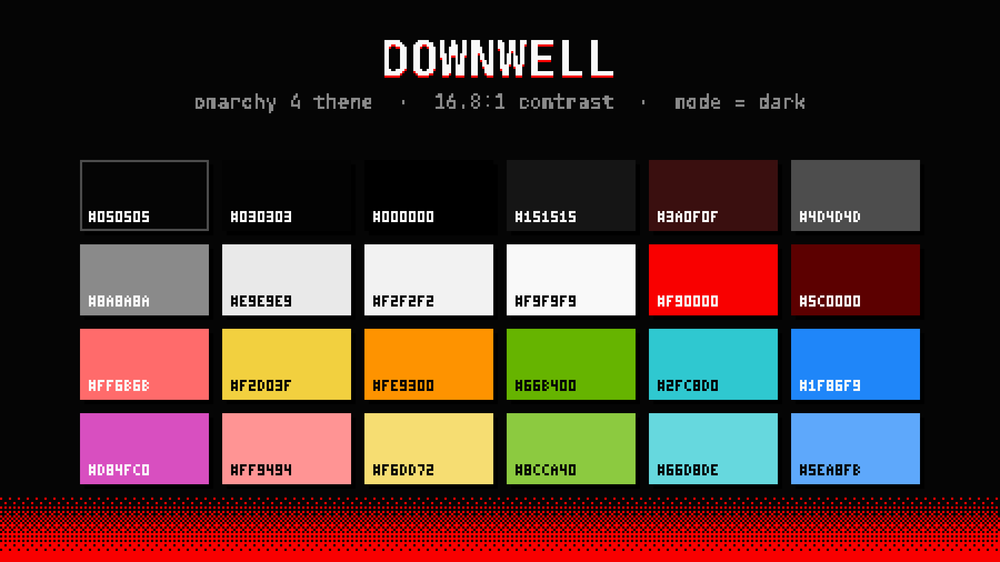

# Downwell

A dark theme for [Omarchy](https://omarchy.org) 4 (Quattro) in the original palette of
[Downwell](https://downwellgame.com): black, white, and one red. An unofficial fan theme;
Downwell is by Moppin, published by Devolver Digital.

The game draws everything in three colors and nothing in between, so the theme does too
wherever it can: a solid red window border with square corners and a hard, unblurred
drop shadow, opaque menus, and the chosen row framed in red the way the game boxes its
selection. Its sister theme, [Downwell Nikaido](https://github.com/LizinDev/omarchy-downwell-nikaido-theme),
uses the game's orange "Nikaido" palette.



## Install

```bash
omarchy theme install https://github.com/LizinDev/omarchy-downwell-theme.git
```

Installing applies the theme right away. To switch back to it later, run
`omarchy theme set downwell`; to uninstall it, run `omarchy theme remove downwell`.

## Palette

| Role | Hex | |
|---|---|---|
| background | `#050505` | the game's black: terminals, bar, popups, menus |
| foreground | `#e9e9e9` | body text, 16.79:1 on background |
| bright_foreground | `#f9f9f9` | the game's white: cursor, sprites |
| accent | `#f90000` | the game's red: borders, selected rows, shortcuts |
| selection | `#3a0f0f` | text selection, btop meters |
| muted | `#4d4d4d` | the game's grey: ANSI bright-black, dividers |

ANSI: `#ff6b6b` red · `#66b400` green · `#f2d03f` yellow · `#1f86f9` blue ·
`#d84fc0` magenta · `#2fc8d0` cyan · `#fe9300` orange. Green is the game's "Matcha"
palette, blue its secondary, orange its "Nikaido" accent.

The accent is the red, so the `red` key cannot be: it draws the wrong-password border
and error text, and a focused window must not look like a failed login. `red` is the
lighter salmon `#ff6b6b` (the game's own "Vboy" secondary), 44.9 dE from the accent.

Saturation is deliberately high. Downwell is one fully saturated color on black, so the
accent stays at 100% and the ANSI colors sit a step below it.

## What's here

| File | |
|---|---|
| `colors.toml` | the palette, from which Omarchy generates every other app's config |
| `hyprland.lua` | solid red border, square corners, hard offset shadow |
| `shell.{menu,launcher,tooltip,lock}.toml` | opaque cards, red selection frame, darker scrim |
| `icons.theme` | `Yaru-red-dark` |
| `backgrounds/` | see below |
| `preview.png` | theme-switcher tile, a pixel-art palette specimen |
| `unlock.png` | Plymouth boot splash and SDDM logo |
| `preview-unlock.png` | the boot splash's preview, which lists the theme in `omarchy plymouth list` |
| `chromium/extras/` | the Chromium companion's code (its art and the theme are built, see below) |
| `tools/` | the scripts that build the backgrounds, previews, shell overrides and the Chromium theme |

## Backgrounds

Only `4-dither.png` ships: the palette's three bands joined by ordered dither, generated
from `colors.toml`. The other six are built from Downwell's own art and stay local. Every
one uses exactly the theme's three colors:

| | |
|---|---|
| `1-clouds.png` | the cloud sea and heart balloon, repainted in this palette's three colors |
| `2-well.png` | a well shaft built from the game's tiles, enemies, gems and HUD |
| `3-title.png` | the DOWNWELL logo over the opening backdrop |
| `5-bros.png` | Super Welltaro Bros.: World 1-1 with gem ? blocks, a slime Goomba, a turtle Koopa and the stone well as the warp pipe |
| `6-terra.png` | Terrawell: a Terraria-style cross-section with the bucket well, the shopkeeper as the Guide, a torchlit tunnel, gem ore and a hotbar |
| `7-isaac.png` | The Welling of Isaac: a basement room with four doors, bubble tears at a fly swarm, a heart pedestal, a tinted gem rock and the minimap |

With your own copy of the game (Steam) and the Omarchywell project checked out at
`~/Projects/Downwell`, rebuild them from `colors.toml`:

```bash
tools/build-backgrounds.sh ~/Projects/Downwell/Wallpaper.png   # omit the argument to skip 1-clouds
```

The scripts read the game's sprites read-only through Omarchywell's
`tools/game_sprites.py`, swap black/white/red for this theme's background, white and
accent (the game's secondary blues and greens fold into the accent or the white), and
scale them 4× on an integer pixel grid.

## Chromium

`tools/chromium.py` builds a Chromium version of the theme into `chromium/`, from
`colors.toml` and the game's own sprites (so, like most backgrounds, it stays local):

- **`chromium/theme`**, a theme extension: the window in the game's black, the well's
  rubble rim along the top of the tab strip with bats and spiders hanging from it past
  the last tab, and a red edge on the selected tab, the way the game underlines what
  is chosen. Chromium's own new tab page gets the title screen's backdrop.
- **`chromium/extras`**, its companion "Downwell Gunboots":
  - a new tab page drawn as the game's title screen, a still: the opening backdrop's
    ledges with the hero dropping in, the logo, a clock, a search box, and your most
    visited sites as a row of icons repainted in the palette's three colors, the chosen
    one framed by the game's cursor corners and the slots left over shown as locked
    upgrade slots. Keys: `1`–`8` open a shortcut (with `Shift`, in a background tab),
    arrows and `Enter` choose one, `/` or just typing searches.
  - a toolbar popup drawn as the pause menu, each setting with an upgrade's icon: sound
    (off by default), page scrollbars, text selection, cursors, focus rings, repainted
    icons, download notices, the death screen, tab group color (off by default), the gem
    count, 24-hour clock, and a row that opens the shop. Today's pages, counted as gems,
    sit in its corner the way the game's HUD counts them.
  - a side panel drawn as the game's shop: the sign, the shopkeeper behind his counter
    with the shop's description box (the item you look at, in full), and three aisles
    (bookmarks, history of the last week, downloads) with folders as upgrade icons,
    prices in gems (a folder's size, a page's visits), and each item's address or
    details under its name in the game's small font. Left and right change aisle,
    `Enter` opens (`Shift` or a middle click: in a background tab, or a download's
    folder), `Backspace` leaves a folder, `Home`/`End`/`PgUp`/`PgDn` jump, typing
    searches, and the gauge on the right can be clicked or dragged. Open it
    from the popup, Chromium's side panel menu, or a shortcut you set for "Open the
    shop" in `chrome://extensions/shortcuts`.
  - on every site, while each is on: scrollbars drawn as the gunboots' ammo gauge (a
    white rim, the charge in red cut into rounds), selected text and the caret in the
    red, and pixel cursors (a white arrow, the arrow in red over anything clickable, an
    I-beam over text fields).
  - a notice when a download ends: the gem sack ("GEM GET!", with the gem sound if
    sound is on) or a skull when it fails.
  - the game's death screen for a page that fails to load, in place of Chromium's error
    page: the hero's grave, "GAME OVER", the results as the game lists them (the area is
    the site, the style what went wrong) and its retry and back icons. `Enter` or `R`
    retries, `Backspace` goes back, and a page lost to a dropped connection retries by
    itself when it returns. Going back to the failed address shows Chromium's own page,
    so the back button never loops; certificate errors keep Chromium's page too.
  - keyboard focus rings on every site in the red (the browser's own stay blue), and
    new tab groups in Chromium's nearest color to it, when that is switched on.

Everything is drawn in the game's fonts and sprites at a whole-number scale.

The companion asks for broad permissions because each part needs one: every site (the
scrollbars, cursors, selection and focus rings), bookmarks, history and downloads (the
shop, the gem count, download notices), navigation events (the death screen) and tab
groups. It has no server and makes no requests of its own; everything it reads stays in
the browser.

### Setup

Omarchy themes Chromium through a managed `BrowserThemeColor` policy, rewritten on
every theme switch, and while that policy exists Chromium refuses theme extensions. So
wiring this in takes one script, run once in a terminal:

```bash
python3 -I tools/chromium.py   # needs ~/Projects/Downwell and the Steam game
tools/chromium-setup           # asks for your password once
```

It installs a theme-set hook (`40-chromium-theme`) that copies the current theme's
`chromium/` build into `~/.local/share/omarchy-chromium-theme/{theme,extras}`, which it
adds to `--load-extension` in `~/.config/chromium-flags.conf`. It also installs
`/usr/local/bin/browser-theme-policy-clear`, root-owned, with a sudoers rule for exactly
that command and no arguments. The hook uses it to delete Omarchy's `color.json` policy
for themes that ship a Chromium build. On any other theme the companion goes to sleep,
Omarchy's color policy stays, and the browser looks as Omarchy made it.
`tools/chromium-setup remove` undoes all of it.

Chromium reads a theme, and an extension's manifest, only when it starts. Switching
from another Omarchy theme, between Downwell and its sister theme, or to a companion
with a new manifest (new permissions or pages after an update) asks for a restart: the
companion shows a `!` badge, a banner on the new tab page, its state in the popup and a
notification. `chrome://restart` reopens your tabs. On a theme without a Chromium build
the companion's new tab page and shop are gone after that restart, too.

Two things neither extension can reach: the browser's own focus rings and profile
button keep Chromium's blue (Chromium only derives those from a seed color, which themes
do not set; focus rings on web pages are red), and incognito windows ignore themes
altogether. Toolbar buttons, menus and Chromium's own pages (settings, downloads)
can only be recolored, never redrawn.

## fastfetch logo

`python3 -I tools/fastfetch.py` draws the hero mid-air as in the clouds background
(`sprPlayerAir` frame 4, at 4x) as a truecolor fastfetch logo in `fastfetch.txt`. Like the sprite
backgrounds it is built from your own copy of the game and stays local. Omarchy has one
global fastfetch logo; the theme-set hook in the
[DORFic theme](https://github.com/LizinDev/omarchy-dorfic-theme) (`tools/fastfetch-hook`)
switches it per theme.

## Caveats

**Installed from a git clone, this theme loses `hyprland.lua`.** Omarchy drops every
`.lua`, terminal config and `vscode.json` from a cloned theme. The palette and border
color survive (they live in `colors.toml`), but not the square corners and hard shadow.

**`shell.*.toml` overrides replace their whole section.** Their hex values are frozen
copies of `colors.toml`. After changing the palette, apply the theme, run
`python3 tools/shell-overrides.py`, then `omarchy theme refresh`.

## Working on it

Keep the repo outside `~/.config/omarchy/themes` and symlink it in. Omarchy treats a
directory with `.git` inside as a cloned theme and stages it with restrictions; it
never treats a symlink that way.

```bash
ln -s ~/Projects/omarchy-downwell-theme ~/.config/omarchy/themes/downwell
omarchy theme set downwell
```

## License

The theme files and build tools are released under the [MIT License](LICENSE). Downwell,
its name and its art belong to Moppin and Devolver Digital. This is a fan theme, not
affiliated with or endorsed by either, and none of the game's sprites are in this
repository.
